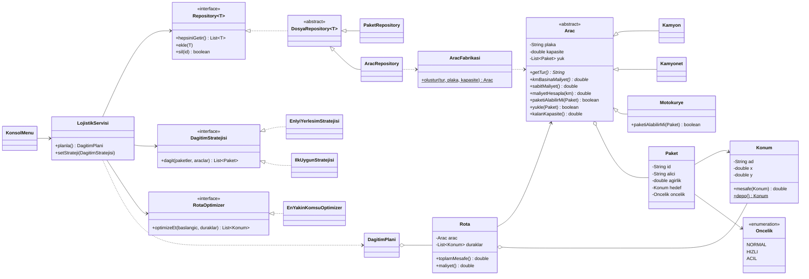

# Akıllı Lojistik Sistemi

Nesneye Yönelik Programlama dersi proje ödevi. Paketleri **araç kapasitesine göre** araçlara dağıtan ve her araç için **en kısa teslimat rotasını** hesaplayan, verileri dosyada kalıcı olarak saklayan bir konsol uygulaması.

## Özellikler
- Paket ve araç ekleme / silme / listeleme (veriler `data/` klasöründe saklanır, program kapanınca kaybolmaz)
- Üç araç türü: **Kamyon**, **Kamyonet**, **Motokurye** (her birinin kapasitesi, km maliyeti ve kuralı farklı)
- Paket öncelikleri: `ACIL` > `HIZLI` > `NORMAL`
- Kapasiteye göre paket dağıtımı (iki farklı strateji, çalışırken değiştirilebilir)
- Rota optimizasyonu (En Yakın Komşu + 2-opt)
- Her rota için mesafe ve maliyet, sığmayan paketlerin raporu

## Kurulum ve Çalıştırma
Gereksinimler: **Java 17+** ve **Maven**

```bash
mvn test                       # birim testlerini çalıştırır
mvn package                    # target/akilli-lojistik-1.0.jar oluşturur
java -jar target/akilli-lojistik-1.0.jar
```
VS Code veya IntelliJ kullanıyorsanız `Main.java` dosyasını açıp **Run** deyin.

> Program `data/` klasörünü çalıştığı dizinde arar; proje kök klasöründen çalıştırın.

## Proje Yapısı
```
src/main/java/com/lojistik/
├── Main.java                  # Giriş noktası, nesneleri birbirine bağlar
├── model/                     # Konum, Paket, Oncelik, Arac (soyut), Kamyon, Kamyonet, Motokurye, Rota
├── strateji/                  # DagitimStratejisi (arayüz), EnIyiYerlesim, IlkUygun
├── rota/                      # RotaOptimizer (arayüz), EnYakinKomsuOptimizer
├── fabrika/                   # AracFabrikasi
├── depo/                      # Repository (arayüz), DosyaRepository, PaketRepository, AracRepository
├── servis/                    # LojistikServisi, DagitimPlani
└── arayuz/                    # KonsolMenu
```

## Kullanılan Algoritmalar

### 1. Paket Dağıtımı: Best Fit Decreasing (Kutu Doldurma)
1. Paketler önce önceliğe (ACIL en önde), sonra ağırlığa (ağır en önde) göre sıralanır.
2. Her paket, onu alabilen araçlar arasından **yüklendikten sonra en az boş yer kalacak** araca konur.
3. Hiçbir araca sığmayan paketler raporlanır.

Böylece araçlar sıkı dolar, gereksiz araç yola çıkmaz. Karşılaştırma için daha basit **First Fit Decreasing** (ilk sığan araca koy) stratejisi de vardır. Örnek veride Best Fit 3 aracı %95–99 doldururken, First Fit bir kamyoneti %1 dolulukla yola çıkarır.

### 2. Rota: En Yakın Komşu + 2-opt (Gezgin Satıcı Problemi)
1. **En Yakın Komşu:** Depodan çık, her seferinde gidilmemiş en yakın durağa git, sonunda depoya dön.
2. **2-opt:** Rotadaki bir parçayı ters çevirmek yolu kısaltıyorsa çevir; iyileşme kalmayana kadar tekrarla. Bu, birbirini kesen yolları açar.

Mesafe, koordinatlar arası Öklid (kuş uçuşu) mesafesidir (km). Maliyet = sabit maliyet + km × km başına maliyet.

## OOP Kavramları
| Kavram | Nerede |
|---|---|
| **Kapsülleme** | Tüm alanlar `private`; `Paket` ve `Arac` kurucuda değer doğrular; `getYuk()` değiştirilemez liste döndürür |
| **Kalıtım** | `Kamyon`, `Kamyonet`, `Motokurye` → `Arac`; `PaketRepository`, `AracRepository` → `DosyaRepository` |
| **Soyutlama** | `Arac` ve `DosyaRepository` soyut sınıf; `DagitimStratejisi`, `RotaOptimizer`, `Repository` arayüz |
| **Çok biçimlilik** | `kmBasinaMaliyet()`, `sabitMaliyet()`, `getTur()` her araçta farklı; `Motokurye.paketiAlabilirMi()` 5 kg üstü paketi reddeder |

## SOLID Prensipleri
| Prensip | Uygulama |
|---|---|
| **S** – Tek Sorumluluk | `KonsolMenu` sadece girdi/çıktı, `LojistikServisi` sadece planlama, repository'ler sadece dosya işleri, optimizer sadece rota yapar |
| **O** – Açık/Kapalı | Yeni araç türü veya yeni dağıtım stratejisi eklemek için servis kodu değişmez, yeni sınıf yazılır |
| **L** – Liskov | Servis ve stratejiler her yerde `Arac` ile çalışır; Kamyon, Kamyonet, Motokurye sorunsuz yerine konabilir |
| **I** – Arayüz Ayrımı | Küçük, tek amaçlı arayüzler: `DagitimStratejisi`, `RotaOptimizer`, `Repository<T>` |
| **D** – Bağımlılığın Ters Çevrilmesi | `LojistikServisi` somut sınıfları değil arayüzleri bilir; hepsi kurucudan verilir (`Main` içinde) |

## Tasarım Kalıpları
1. **Strategy:** `DagitimStratejisi` → `EnIyiYerlesimStratejisi`, `IlkUygunStratejisi`. Menüden çalışma anında değiştirilir.
2. **Factory:** `AracFabrikasi.olustur(tur, plaka, kapasite)`. Menü ve dosya okuma, somut araç sınıflarını bilmez.
3. **Repository:** `Repository<T>` arayüzü, verinin dosyada saklandığını servisten gizler.

## Kalıcı Veri
`data/araclar.txt` → `tur;plaka;kapasite`
`data/paketler.txt` → `id;alici;agirlik;konumAdi;x;y;oncelik`

Her ekleme/silme işleminden sonra dosya hemen güncellenir.

## Birim Testleri (13 adet, JUnit 5)
- **ModelTest:** mesafe hesabı, geçersiz paket, kapasite aşımı, motokurye kuralı, maliyet çok biçimliliği, fabrika
- **AlgoritmaTest:** Best Fit doğru aracı seçer, acil paket önceliği, rota depoda başlar/biter, 2-opt rotayı uzatmaz
- **KaliciVeriVeServisTest:** dosyaya yaz-oku, aynı plaka engeli, sığmayan paket raporu

## UML Sınıf Diyagramı
Ayrıca `uml.puml` (PlantUML) dosyası olarak da vardır.



## Ekip
Bkz. `proje_takimi.txt`